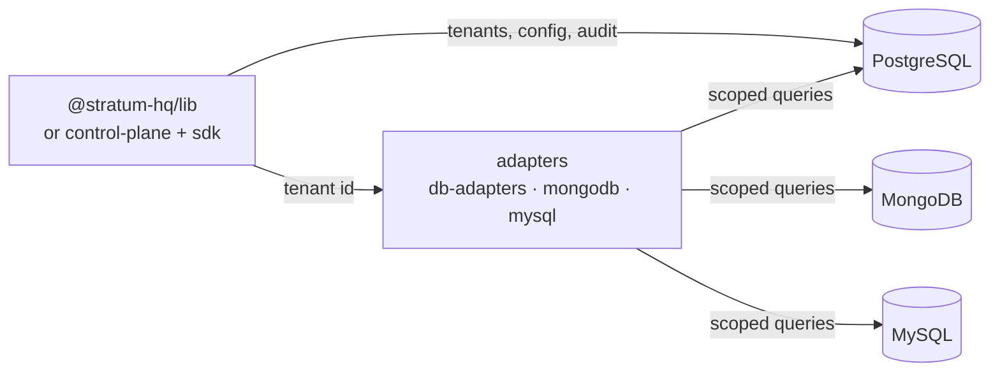

<p align="center">
  <picture>
    <source media="(prefers-color-scheme: dark)" srcset="assets/brand/stratum-lockup.svg" />
    
  </picture>
</p>

<p align="center">
  <strong>Drop-in multi-tenancy for Node.js</strong>: tenant hierarchy, config inheritance, permissions, audit, and GDPR in one library.
</p>

<p align="center">
  <a href="https://github.com/stratum-hq/Stratum/actions/workflows/ci.yml"></a>
  <a href="https://www.npmjs.com/package/@stratum-hq/lib"></a>
  
  <a href="https://github.com/stratum-hq/Stratum/releases"></a>
  
  <a href="LICENSE"></a>
</p>

<p align="center">
  <a href="https://stratum-hq.org/"><strong>Website</strong></a> ·
  <a href="https://docs.stratum-hq.org/"><strong>Docs</strong></a> ·
  <a href="https://docs.stratum-hq.org/playground/"><strong>Playground</strong></a> ·
  <a href="#quick-start"><strong>Quick start</strong></a>
</p>



## Why Stratum

Every SaaS team starts with `tenant_id` on every table. It works until the product needs more than a filter:

- An enterprise customer wants its own settings, so you hand-roll config tables with no inheritance.
- A compliance audit lands, and you scramble to add audit logging, data export, and purge.
- A large customer demands data isolation, and you migrate off shared tables to schema-per-tenant while it's live.

We built Stratum so none of those turn into a rewrite. Tenants are a tree in PostgreSQL, stored as an `ltree` path, with advisory locks around create and move. Config resolves root to leaf, and a parent can lock a key for its whole subtree. Permissions flow down the tree as LOCKED, INHERITED, or DELEGATED, with cascade revocation, and ABAC policies resolve deny-overrides-allow. You can start flat: an organization is just a root tenant, so you add children under it when you need them.

Around that core: three PostgreSQL isolation strategies (shared tables with RLS, schema-per-tenant, database-per-tenant) chosen per tenant, with parallel strategies for MongoDB and MySQL. There's also AES-256-GCM field encryption with key rotation, an audit log with before/after state, GDPR export (Article 20) and hard purge (Article 17), signed webhooks with retries and a dead letter queue, scoped API keys, and multi-region. We built it for B2B SaaS and MSP/MSSP products, where tenants nest.

## Requirements

- **Node.js 20 or later.**
- **PostgreSQL 16 or later**, with the `uuid-ossp` and `ltree` extensions. Stratum's own tables always live here, even when your application data is in MongoDB or MySQL. The first migration creates both extensions if its role is allowed to.
- **MongoDB 6.0 or later**, only for `@stratum-hq/mongodb`. Its `watchDeletes` change-stream option needs a replica set or a sharded cluster.
- **MySQL 8**, only for `@stratum-hq/mysql`.

## Install

```bash
npm install @stratum-hq/lib pg
```

To start a new project instead, `npx @stratum-hq/create my-app` scaffolds one with Docker and migrations (`--template express`, `fastify`, or `nextjs`). The other packages are in the [installation guide](https://docs.stratum-hq.org/getting-started/installation/#additional-packages).

## Quick start

```typescript
import { Pool } from "pg";
import { Stratum } from "@stratum-hq/lib";

const stratum = new Stratum({
  pool: new Pool({ connectionString: process.env.DATABASE_URL }),
  autoMigrate: true,
});
await stratum.initialize();

const org = await stratum.createOrganization({ name: "Acme Corp", slug: "acme" });
await stratum.setConfig(org.id, "seat_limit", { value: 25 });

const config = await stratum.resolveConfig(org.id);
console.log(config.seat_limit.value); // 25
```

`autoMigrate: true` creates Stratum's tables on the first `initialize()`. There's no CLI step and no Docker requirement, only a PostgreSQL connection string. Pass it as `connectionString`: a bare `new Pool()` reads only the `PG*` variables (`PGHOST`, `PGUSER`, `PGDATABASE`, and so on), not `DATABASE_URL`.

The first run logs a warning that Stratum was created without `adminPool` and uses the legacy `app.bypass_rls` path. That's normal for a single pool in 1.x. `adminPool` becomes required in 2.0, and [Hardening: separate admin and app roles](https://docs.stratum-hq.org/guides/hardening-roles/) shows how to set it up. Outside `NODE_ENV=development` or `test`, Stratum also refuses to start without `STRATUM_ENCRYPTION_KEY` and `STRATUM_HKDF_SALT`; see [environment variables](https://docs.stratum-hq.org/getting-started/installation/#environment-variables).

When you're ready for parent and child tenants:

```typescript
const msp = await stratum.createTenant({ name: "NorthStar MSP", slug: "northstar" });
const client = await stratum.createTenant({ name: "Client Alpha", slug: "client_alpha", parent_id: msp.id });

await stratum.setConfig(msp.id, "max_seats", { value: 500, locked: true });
const resolved = await stratum.resolveConfig(client.id);
// resolved.max_seats → { value: 500, inherited: true, locked: true, source_tenant_id: msp.id }
```

A locked key can't be overridden anywhere below the tenant that locked it.

## Packages

Start with one of these:

| Package | Use it for |
|---|---|
| [`@stratum-hq/lib`](https://docs.stratum-hq.org/packages/lib/) | The library, embedded in your Node.js process with no HTTP hop. |
| [`@stratum-hq/sdk`](https://docs.stratum-hq.org/packages/sdk/) | An HTTP client for the control plane, with an LRU cache and Express/Fastify middleware. |
| [`@stratum-hq/create`](https://docs.stratum-hq.org/packages/create/) | Scaffolding a new project: `npx @stratum-hq/create my-app`. |

The rest are on the [packages list](https://docs.stratum-hq.org/#packages): PostgreSQL ORM adapters, MongoDB and MySQL isolation, NestJS and Hono integrations, React admin components, the `stratum` CLI, cross-tenant test helpers, and the `@stratum-hq/compliance` kernel.

## How it works

There are two ways in. `@stratum-hq/lib` runs inside your process and talks to PostgreSQL directly. `@stratum-hq/control-plane` is a Fastify v5 REST API over the same library, with scoped API keys, OpenTelemetry spans, and per-key rate limits that use Redis when `REDIS_URL` is set. Your services reach it through `@stratum-hq/sdk`.

Either way, the adapters scope your own queries to the current tenant: RLS, schema, or database routing on PostgreSQL, and the equivalent strategies on MongoDB and MySQL. The data model is in [Core concepts](https://docs.stratum-hq.org/getting-started/concepts/).

## Running the demo

```bash
docker compose --profile demo up --build
```

This builds and starts PostgreSQL, the control plane, and an MSSP demo app with seeded tenants.

| Service | URL |
|---|---|
| Dashboard | http://localhost:3300 |
| API | http://localhost:3001 |
| Swagger | http://localhost:3001/api/docs |

## Documentation

Everything else is at [docs.stratum-hq.org](https://docs.stratum-hq.org/).

| Section | What's there |
|---|---|
| [Start](https://docs.stratum-hq.org/start/) | A wizard that builds the `npx @stratum-hq/create` command for your database, isolation strategy, ORM, and framework. |
| [Installation](https://docs.stratum-hq.org/getting-started/installation/) | Prerequisites, every package, database setup, and environment variables. |
| [Core concepts](https://docs.stratum-hq.org/getting-started/concepts/) | Tenant trees, config inheritance, delegation, isolation, and the architecture. |
| [Guides](https://docs.stratum-hq.org/guides/tenant-hierarchy/) | Hierarchy, config, permissions, ABAC, isolation, API keys, webhooks, GDPR, multi-region, and ORM setups. |
| [API reference](https://docs.stratum-hq.org/api/tenants/) | The control plane's REST routes. |
| [Playground](https://docs.stratum-hq.org/playground/) | Stratum in your browser, with no install. |
| [Roadmap](https://stratum-hq.org/blog/whats-next-for-stratum/) | What we're working on next. |

## Development

```bash
npm ci
npm run verify        # lint, typecheck, unit tests, build
npm run lint:secrets  # the secret scan CI runs
```

The unit tests need no database. The integration suites run against real PostgreSQL, MongoDB, and MySQL; the steps are in [CONTRIBUTING.md](CONTRIBUTING.md#running-tests). To run the docs site locally: `cd website && npm install && npm run dev`.

## Security

Please don't report vulnerabilities in public issues. [SECURITY.md](SECURITY.md) has the private reporting address and what to expect.

## License

MIT. See [LICENSE](LICENSE).
